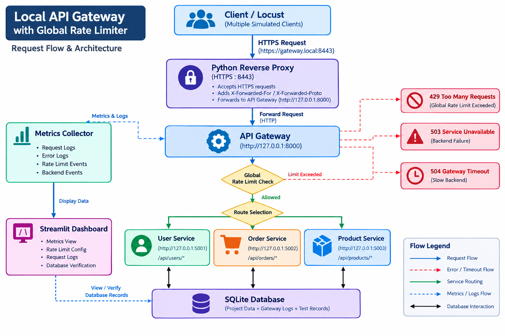

# Local API Gateway with Global Rate Limiter

A beginner-friendly local API Gateway project built using Python and Flask.

This project demonstrates how an API Gateway can sit between a client and multiple backend services. The Gateway handles request routing, global rate limiting, backend failures, timeouts, metrics, concurrency, and testing through Locust.

The project also includes a simulated deployment and networking setup using:

- A simulated server IP
- A simulated local domain
- HTTPS
- A Python reverse proxy
- Trusted proxy handling
- Windows Firewall configuration
- Locust load testing
- SQLite database for project and test records
- Streamlit dashboard for monitoring and verification

The complete project runs locally and does not require AWS or any cloud service.

---

# Project Objective

The main objective of this project is to build a simple API Gateway that can:

- Route requests to different backend services
- Apply a global rate limit
- Support Fixed Window and Sliding Window rate limiting
- Handle backend failures without crashing the Gateway
- Handle slow backend services using timeouts
- Collect request and error metrics
- Store project and testing records in SQLite
- Show metrics through a Streamlit dashboard
- Test concurrent requests safely
- Support multiple simulated client IPs
- Allow rate-limit configuration at runtime
- Simulate basic deployment and networking concepts
- Test the Gateway using Locust

---

# Architecture

The basic local architecture is:

    Client / Locust
          |
          v
    HTTPS Reverse Proxy :8443
          |
          v
    API Gateway :8000
          |
          +-----------------------+
          |           |           |
          v           v           v
       User        Order       Product
       Service     Service     Service
       :5001       :5002       :5003

The actual Gateway routing is:

    /api/users/*      -> User Service :5001

    /api/orders/*     -> Order Service :5002

    /api/products/*  -> Product Service :5003

The client does not directly access the backend services during the simulated deployment test.

---

# System Flowchart

# Simulated Deployment and Networking

The project includes a local deployment and networking simulation.

No real cloud server or production infrastructure is used.

The simulated request path is:

    Locust / Client
          |
          | HTTPS
          v
    gateway.local:8443
          |
          | Python Reverse Proxy
          v
    API Gateway :8000
          |
          +-----------------------+
          |           |           |
          v           v           v
       User        Order       Product
       :5001       :5002       :5003

The request flow is:

1. The client sends a request to the simulated domain.
2. The request uses HTTPS.
3. The request reaches the local Python reverse proxy.
4. The reverse proxy forwards the request to the API Gateway.
5. The Gateway checks the request and global rate limit.
6. The Gateway forwards the request to the correct backend.
7. The backend response goes back through the Gateway and proxy.
8. The response is returned to the client.

This simulates a basic deployed networking path without using a real cloud server.

---

# Simulated Server IP

The local machine was used as the simulated server.

The simulated LAN IP used during deployment testing was:

    10.10.76.14

This is a local/LAN IP address.

It is not a public Internet IP.

The IP was used to demonstrate how a server could be reached through a network address during deployment testing.

---

# Simulated Domain

A local domain was configured for the simulated Gateway:

    gateway.local

The Windows hosts file maps the domain to the simulated server IP:

    10.10.76.14 gateway.local

This allows requests such as:

    https://gateway.local:8443

to reach the local machine.

This is a local domain simulation and is not a real public DNS domain.

---

# HTTPS Simulation

HTTPS was enabled for the simulated reverse proxy.

The HTTPS endpoint is:

    https://gateway.local:8443

A self-signed certificate is used for local testing.

Because the certificate is self-signed, testing tools such as curl and Locust are configured to accept the certificate during local testing.

A real production deployment would normally use a trusted TLS certificate from a Certificate Authority.

---

# Python Reverse Proxy

A Python-based reverse proxy is used in front of the API Gateway.

The reverse proxy listens on:

    0.0.0.0:8443

and forwards requests to:

    http://127.0.0.1:8000

The reverse proxy handles:

- HTTPS requests
- Request forwarding
- HTTP methods
- Request headers
- Request bodies
- Query parameters
- X-Forwarded-For
- X-Forwarded-Proto
- Proxy identification
- Gateway responses
- Proxy connection errors

The Python reverse proxy is used because the deployment requirement is a local simulation rather than a production deployment.

---

# Trusted Proxy and Client IP Handling

The Gateway supports trusted proxy handling.

The Gateway does not blindly trust the X-Forwarded-For header from every client.

The Gateway first checks whether the immediate request source is a configured trusted proxy.

Only a trusted proxy can provide forwarded client IP information.

The trusted proxy configuration is stored in:

    config.py

The simulated Python reverse proxy acts as the trusted proxy.

This prevents a normal client from simply sending a fake X-Forwarded-For header to change its rate-limit identity.

During the deployment simulation, the client IP can be forwarded through the trusted proxy path.

---

# Firewall Simulation

Windows Firewall was used to simulate a network security rule for the HTTPS entry point.

The firewall rule allows inbound traffic for:

    TCP port 8443

The firewall rule used during testing was:

    API Gateway HTTPS Simulation

The rule demonstrates how a deployed server can restrict which ports are allowed to receive incoming traffic.

This is only a local deployment simulation and is not a production firewall configuration.

---

# Technologies Used

- Python
- Flask
- Requests
- Streamlit
- SQLite
- Threading
- Concurrent Futures
- Unittest
- Locust
- PowerShell
- VS Code
- Windows Firewall
- HTTPS / TLS

---

# Project Structure

    local-api-gateway/
    |
    +-- dashboard/
    |   +-- app.py
    |
    +-- gateway/
    |   +-- app.py
    |
    +-- metrics/
    |   +-- metrics.py
    |
    +-- rate_limiter/
    |   +-- __init__.py
    |   +-- fixed_window.py
    |   +-- sliding_window.py
    |
    +-- services/
    |   +-- user_service/
    |   |   +-- app.py
    |   |
    |   +-- order_service/
    |   |   +-- app.py
    |   |
    |   +-- product_service/
    |       +-- app.py
    |
    +-- proxy/
    |   +-- app.py
    |   +-- certs/
    |
    +-- database/
    |   +-- database.py
    |   +-- gateway.db
    |
    +-- tests/
    |   +-- test_rate_limiter.py
    |   +-- test_routing.py
    |   +-- test_failures.py
    |   +-- test_timeout.py
    |   +-- test_metrics.py
    |
    +-- config.py
    +-- locustfile.py
    +-- test_concurrency.py
    +-- test_multiple_clients.py
    +-- test_sliding_boundary.py
    +-- test_fixed_boundary.py
    +-- requirements.txt
    +-- README.md

---

# Backend Services

The project contains three simple Flask backend services.

## 1. User Service

Runs on:

    http://127.0.0.1:5001

Endpoints:

- GET /users
- POST /users

The POST endpoint accepts a JSON object.

It validates:

- name
- email

The endpoint also helps verify request-body and header forwarding through the Gateway.

---

## 2. Order Service

Runs on:

    http://127.0.0.1:5002

Endpoints:

- GET /orders
- POST /orders
- GET /slow-orders

The /slow-orders endpoint intentionally waits for 5 seconds.

It is used to test the Gateway timeout.

---

## 3. Product Service

Runs on:

    http://127.0.0.1:5003

Endpoints:

- GET /products
- POST /products

The POST endpoint validates the product name and price.

---

# API Gateway

The Gateway runs locally on:

    http://127.0.0.1:8000

The Gateway receives client requests and forwards them to the correct backend service.

During deployment simulation, the client uses:

    https://gateway.local:8443

The reverse proxy forwards the request to:

    http://127.0.0.1:8000

---

# Gateway Routes

## User Route

    GET /api/users/users

The Gateway forwards the request to:

    http://127.0.0.1:5001/users

---

## Order Route

    GET /api/orders/orders

The Gateway forwards the request to:

    http://127.0.0.1:5002/orders

---

## Product Route

    GET /api/products/products

The Gateway forwards the request to:

    http://127.0.0.1:5003/products

---

# Request Forwarding

The Gateway supports:

- GET
- POST
- PUT
- DELETE

The Gateway forwards:

- HTTP method
- Request headers
- Request body
- Query parameters

Hop-by-hop HTTP headers are excluded when forwarding requests and responses.

This allows the client to communicate with backend services through the Gateway.

---

# Global Rate Limiting

The project uses a global rate limiter.

The rate limit is not separate for every IP.

The same global counter is shared by all simulated client IPs.

For example, if the limit is:

    100 requests / 60 seconds

and three simulated clients send:

    Client 1 = 40 requests
    Client 2 = 30 requests
    Client 3 = 30 requests

then:

    Total = 100 requests

The next request from any client is blocked with:

    429 Too Many Requests

This means the rate limit is applied globally across the Gateway.

Multiple simulated IPs are still used during Locust testing, but they share the same global rate-limit counter.

---

# Fixed Window Rate Limiting

Fixed Window divides time into fixed intervals.

Example:

    Limit = 2 requests
    Window = 5 seconds

The Gateway allows 2 requests during the current fixed window.

After the next fixed window starts, the counter is reset.

### Advantages

- Simple to understand
- Simple to implement
- Uses less memory
- Easy to maintain

### Limitation

Requests near a window boundary can create a burst.

---

# Sliding Window Rate Limiting

Sliding Window checks requests made during the previous time period.

Example:

    Limit = 2 requests
    Window = 5 seconds

The Gateway stores recent request timestamps.

When a new request arrives, timestamps outside the active window are removed.

### Advantages

- More accurate around window boundaries
- Reduces the burst problem of Fixed Window

### Limitations

- Stores request timestamps
- Uses more memory
- Requires more processing than Fixed Window

---

# Rate Limiter Storage

Rate-limit state is stored in memory.

Fixed Window stores:

- Current window start time
- Request count

Sliding Window stores:

- Recent request timestamps

The rate limiter uses Python threading locks to protect shared state.

The rate-limit state is global for the Gateway.

When the Gateway restarts, the in-memory rate-limit state is cleared.

---

# Rate Limit Concurrency

The rate limiter uses threading locks.

This protects shared state when many requests arrive at the same time.

For example:

    Limit = 2 requests

If 10 requests arrive almost simultaneously, the lock ensures that only the configured number of requests are allowed.

The remaining requests receive:

    429 Too Many Requests

The same global counter is used even when different simulated client IPs are used.

---

# Current Rate Limit

The default configuration is:

    Algorithm: Sliding Window
    Limit: 2 requests
    Window: 5 seconds

This configuration is defined in:

    config.py

The rate limit can also be changed at runtime using:

    POST /api/rate-limit

The dashboard can also be used to change the configuration.

For normal Locust testing, a higher temporary limit can be configured so that normal traffic can be tested without being blocked.

---

# Rate Limit API

The Gateway provides:

    GET /api/rate-limit

This returns the current configuration.

Example:

    {
        "limit": 2,
        "window_seconds": 5,
        "algorithm": "sliding"
    }

The configuration can be changed using:

    POST /api/rate-limit

Example:

    {
        "limit": 5,
        "window_seconds": 10,
        "algorithm": "sliding"
    }

Supported algorithms:

    fixed
    sliding

The Gateway validates the configuration before applying it.

When the configuration changes, existing rate-limit state is cleared so that the new configuration starts with fresh state.

---

# Rate Limit Response

When the global limit is not exceeded:

    200 OK

When the global limit is exceeded:

    429 Too Many Requests

Example:

    {
        "error": "Rate limit exceeded"
    }

---

# Backend Failure Handling

The Gateway remains available even if a backend service is unavailable.

For example, if the Order Service is stopped:

    Client
       |
       v
    Gateway :8000
       |
       X
    Order Service :5002

The Gateway returns:

    503 Service Unavailable

Example:

    {
        "error": "Backend service unavailable"
    }

Other backend services can continue working.

For example, if the Order Service is stopped, the Product Service can still return:

    200 OK

This demonstrates failure isolation.

---

# Backend Timeout

The Gateway uses a finite backend timeout.

Current timeout:

    2 seconds

The Order Service contains:

    /slow-orders

The service waits for 5 seconds before responding.

Because the Gateway timeout is 2 seconds, the Gateway returns:

    504 Gateway Timeout

Example:

    {
        "error": "Backend service timeout"
    }

This prevents a slow backend from keeping the Gateway request open indefinitely.

---

# Metrics

The Gateway collects basic metrics in memory.

Available metrics include:

- Total requests
- Allowed requests
- Rate-limited requests
- Backend errors
- Backend timeouts
- Endpoint
- Client IP
- Timestamp
- HTTP status code
- Response time

Metrics are available through:

    GET /api/metrics

Example:

    {
        "total_requests": 10,
        "allowed_requests": 8,
        "blocked_requests": 2,
        "backend_errors": 0,
        "backend_timeouts": 0
    }

Detailed request logs are also included in the metrics response.

Metrics are kept in memory and are separate from the persistent SQLite testing records.

---

# Metrics Reset

The Gateway provides:

    POST /api/metrics/reset

Example response:

    {
        "message": "Metrics reset successfully"
    }

This resets the in-memory metrics.

It resets:

- Total requests
- Allowed requests
- Blocked requests
- Backend errors
- Backend timeouts
- Request logs

Resetting metrics does not change the configured rate limit.

---

# Health Check

The Gateway provides:

    GET /api/health

Example response:

    {
        "status": "healthy"
    }

This endpoint can be used to check whether the Gateway is running.

---

# SQLite Database

The project uses SQLite as the central project database.

The database is used to store project data and testing evidence.

The database contains records for:

- Users
- Orders
- Products
- Gateway requests
- Rate-limit events
- Backend events
- Test runs
- Test results

The database is shared by the complete project.

Separate databases are not used for individual services.

---

# Database Verification

The Streamlit dashboard contains a Database Verification section.

The dashboard shows:

- Users
- Orders
- Products
- Test Results

The Users, Orders and Products sections show both:

- Stored entity records
- API request records related to that service

The API request records include actual HTTP request information such as:

- Request ID
- HTTP method
- Endpoint
- Client IP
- HTTP status code
- Response time
- Timestamp

The Test Results section shows:

- Locust test results
- HTTP status records stored by the Gateway

The database can also be reset from the dashboard.

---

# Database Serial IDs

The dashboard displays serial numbers for database tables where required.

These displayed serial numbers are generated only for dashboard presentation.

They do not modify the actual SQLite database IDs.

The original database records remain unchanged.

---

# Streamlit Dashboard

The project includes a Streamlit dashboard for monitoring and verification.

The dashboard provides:

- Gateway metrics
- Rate-limit configuration
- Fixed Window selection
- Sliding Window selection
- Backend health information
- HTTP status summary
- Request logs
- Metrics reset
- Database verification
- Database reset

The dashboard does not replace Locust.

Locust is used separately for load and concurrency testing.

---

# Dashboard Rate Limit Configuration

The dashboard can read the current Gateway rate-limit configuration.

It displays:

- Requests allowed
- Window seconds
- Algorithm

The available algorithms are:

    fixed
    sliding

The dashboard can send a runtime configuration request to the Gateway.

---

# Dashboard Request Logs

The dashboard displays request logs collected by the Gateway.

The logs include information such as:

- Timestamp
- Endpoint
- Client IP
- HTTP status code
- Response time
- Rate-limit information
- Backend error information
- Backend timeout information

---

# Locust Load Testing

Locust is used as the external traffic generator.

Locust sends requests to:

    https://gateway.local:8443

The test path is:

    Locust
       |
       | HTTPS
       v
    gateway.local:8443
       |
       v
    Python Reverse Proxy
       |
       v
    API Gateway :8000
       |
       +------------+------------+
       |            |            |
       v            v            v
     Users        Orders      Products

Locust does not directly call the backend services.

---

# Simulated Client IPs in Locust

Locust creates multiple simulated client IPs using:

    X-Forwarded-For

The simulated IPs are used to demonstrate multiple clients.

The reverse proxy forwards the client IP to the Gateway.

The Gateway accepts the forwarded client IP only through the trusted proxy path.

Even though multiple simulated IPs are used, the rate limiter is global.

All clients share the same global rate-limit counter.

---

# Normal Locust Load Test

A normal Locust load test was performed using:

    Users: 10
    Spawn Rate: 2 users/second

The test produced:

    Total Requests: 410
    Failures: 0
    Failure Rate: 0%
    Requests/Second: 6.4
    Average Response Time: 44.33 ms

The tested path was:

    Locust
        ->
    HTTPS
        ->
    gateway.local:8443
        ->
    Reverse Proxy
        ->
    API Gateway
        ->
    Backend Services

---

# Locust Rate Limit Test

A separate rate-limit test was performed using:

    Limit: 2 requests
    Window: 5 seconds
    Algorithm: Sliding Window

Multiple simulated clients were used.

Because the rate limit is global, requests from different simulated IPs use the same Gateway-wide rate-limit counter.

After the configured global limit is reached, additional requests receive:

    429 Too Many Requests

The 429 responses are rate-limit results and are not treated as backend failures.

---

# Testing

The project includes automated tests using Python unittest.

The tests cover:

- Fixed Window rate limiting
- Sliding Window rate limiting
- Rate-limit concurrency
- Gateway routing
- Unknown services
- Backend connection failures
- Backend HTTP errors
- Backend timeouts
- Metrics collection
- Metrics reset

Run the automated test suite using:

    python -m unittest discover -s tests -v

The automated test suite completed successfully with:

    16 tests passed

Additional manual scripts are included for:

- Concurrent requests
- Multiple clients
- Fixed Window boundary testing
- Sliding Window boundary testing

---

# Manual Testing

The project was manually tested for:

## Normal Routing

    /api/users/users
    /api/orders/orders
    /api/products/products

## Unknown Route

    /api/payment/payments

Expected result:

    404

## Query Parameters

Query parameters were tested through the Gateway.

Example:

    /api/users/users?id=10

The query parameters are forwarded to the backend.

## POST Body and Headers

POST requests were tested through the Gateway with:

- JSON request body
- Custom headers

The backend receives the forwarded request data.

## Global Rate Limit

Multiple requests were sent quickly to verify:

    200
    200
    429

with:

    2 requests / 5 seconds

The same global counter is used for all clients.

## Backend Failure

The Order Service was stopped.

The Gateway returned:

    503

Other backend services continued working.

## Timeout

The slow Order endpoint was tested.

The Gateway returned:

    504

after the configured timeout.

## Concurrent Requests

Multiple requests were tested concurrently to verify that the rate limiter remains thread-safe.

## Multiple Simulated Clients

Multiple simulated client IPs were tested through Locust.

The clients share the same global rate-limit counter.

## Window Boundary

Both Fixed Window and Sliding Window behavior were tested around the time-window boundary.

## Metrics Reset

Metrics were collected and then reset through the reset endpoint.

The metrics returned to zero.

## Gateway Restart

The Gateway was stopped and restarted to verify that it can recover and serve requests again.

## Deployment Networking

The simulated deployment path was tested using:

    gateway.local
    10.10.76.14
    HTTPS :8443
    Python Reverse Proxy
    Windows Firewall
    Locust

The complete request path was successfully tested through HTTPS.

---

# Configuration

Main configuration is stored in:

    config.py

Current default values:

    Gateway:
    127.0.0.1:8000

    User Service:
    127.0.0.1:5001

    Order Service:
    127.0.0.1:5002

    Product Service:
    127.0.0.1:5003

    Rate Limit:
    2 requests / 5 seconds

    Algorithm:
    Sliding Window

    Backend Timeout:
    2 seconds

Trusted proxy configuration is also stored in:

    config.py

The simulated HTTPS reverse proxy uses:

    gateway.local:8443

---

# How to Run the Project

## 1. Create Virtual Environment

On Windows PowerShell:

    python -m venv venv

Activate it:

    .\venv\Scripts\Activate.ps1

---

## 2. Install Dependencies

Install dependencies from requirements.txt:

    pip install -r requirements.txt

---

## 3. Start User Service

Open a terminal:

    python services/user_service/app.py

The User Service runs on:

    http://127.0.0.1:5001

---

## 4. Start Order Service

Open another terminal:

    python services/order_service/app.py

The Order Service runs on:

    http://127.0.0.1:5002

---

## 5. Start Product Service

Open another terminal:

    python services/product_service/app.py

The Product Service runs on:

    http://127.0.0.1:5003

---

## 6. Start Gateway

Open another terminal and activate the virtual environment.

Run:

    python -m gateway.app

The Gateway runs on:

    http://127.0.0.1:8000

---

## 7. Start Reverse Proxy

Open another terminal and run:

    python proxy/app.py

The simulated HTTPS endpoint is:

    https://gateway.local:8443

The proxy forwards requests to:

    http://127.0.0.1:8000

---

## 8. Start Dashboard

Open another terminal and run:

    streamlit run dashboard/app.py

The dashboard normally runs at:

    http://localhost:8501

---

## 9. Start Locust

Open another terminal and run:

    locust -f .\locustfile.py --host https://gateway.local:8443

Then open:

    http://localhost:8089

Set the required number of users and spawn rate and start the test.

---

# Example Request Flow

A client sends:

    GET /api/users/users

The simulated deployment request path is:

    Client
        |
        v
    https://gateway.local:8443
        |
        v
    Python Reverse Proxy
        |
        v
    API Gateway :8000

The Gateway then:

1. Identifies the client
2. Checks the global rate limit
3. Selects the correct backend service
4. Sends the request to the backend
5. Waits for the backend response
6. Records metrics
7. Stores the request record in SQLite
8. Returns the response to the client

The client does not need to directly access the backend service.

---

# Design Decisions

## Why Flask?

Flask is lightweight and easy to understand.

It is suitable for demonstrating API Gateway concepts without unnecessary complexity.

## Why Requests?

The Requests library is used by the Gateway to communicate with backend services.

## Why Locks?

Multiple requests can arrive at the same time.

Locks protect shared counters, rate-limit state, metrics, and configuration from race conditions.

## Why Sliding Window?

Sliding Window gives more accurate behavior around time-window boundaries.

Fixed Window is also implemented so both algorithms can be compared.

## Why Global Rate Limiting?

The assignment testing setup uses a Gateway-wide request limit.

A global counter makes the rate limiter apply the configured limit across all simulated client IPs.

This also makes it possible to test whether requests from different clients together reach the same Gateway-wide threshold.

## Why In-Memory Rate Limiter Storage?

This is a local internship assignment.

In-memory storage keeps the rate limiter simple and easy to understand.

The trade-off is that rate-limit state is lost when the Gateway restarts.

## Why SQLite?

SQLite provides a simple central database without requiring an external database server.

It is used to store:

- Project data
- Gateway request records
- Rate-limit events
- Backend events
- Test runs
- Test results

## Why a Python Reverse Proxy?

The deployment requirement is simulated locally.

A Python reverse proxy demonstrates:

- HTTPS entry point
- Request forwarding
- Forwarded client IP
- Proxy-to-Gateway communication

without adding production infrastructure.

## Why Not a Real Cloud Server?

The project focuses on:

- API Gateway concepts
- Routing
- Rate limiting
- Failure handling
- Timeouts
- Concurrency
- Metrics
- Testing

Therefore, deployment and networking are simulated locally.

---

# Error Handling

The Gateway uses controlled JSON responses.

## Unknown Service

    404 Not Found

Example:

    {
        "error": "Unknown service"
    }

## Route Not Found

    404 Not Found

Example:

    {
        "error": "Route not found"
    }

## Method Not Allowed

    405 Method Not Allowed

Example:

    {
        "error": "Method not allowed"
    }

## Invalid Request Body

    400 Bad Request

Example:

    {
        "error": "Request body must be a JSON object"
    }

## Rate Limit Exceeded

    429 Too Many Requests

## Backend Unavailable

    503 Service Unavailable

## Backend Timeout

    504 Gateway Timeout

The Gateway does not expose backend stack traces or unnecessary internal details to the client.

---

# Current Limitations

This project is designed for local development, learning, testing, and deployment simulation.

Current limitations include:

- Metrics are stored in memory
- In-memory metrics are lost when the Gateway restarts
- Rate-limit state is lost when the Gateway restarts
- The Gateway does not provide authentication
- The runtime rate-limit configuration endpoint should not be publicly exposed without access control
- Client IP handling depends on the trusted proxy configuration
- The HTTPS certificate is self-signed
- gateway.local is a local simulated domain
- 10.10.76.14 is a local/LAN IP and not a public Internet IP
- The project does not use a real public cloud server
- The project does not use production DNS
- The project does not use a production Certificate Authority
- The Python reverse proxy is not intended to replace a production-grade reverse proxy
- Backend services are intentionally simple Flask applications
- Rate-limit configuration exists in the running Gateway process
- SQLite is intended for this local project and not as a distributed production database

These limitations are acceptable for the local internship assignment and deployment simulation.

---

# Future Improvements

Possible future improvements include:

- Redis-based distributed rate limiting
- Persistent metrics storage
- Authentication and authorization
- More backend services
- Better dashboard charts
- Configurable backend URLs
- More HTTP method testing
- Production-grade logging
- Distributed Gateway instances
- Health monitoring for individual backend services
- Production reverse proxy such as Nginx
- Production TLS certificates
- Real cloud deployment
- Real DNS configuration
- Production load balancing

---

# Learning Outcomes

This project demonstrates practical concepts including:

- API Gateway architecture
- HTTP request routing
- Request body forwarding
- Header forwarding
- Query parameter forwarding
- Global rate limiting
- Fixed Window algorithm
- Sliding Window algorithm
- Rate-limit configuration
- Thread safety
- Concurrent requests
- Multiple simulated clients
- Backend failure isolation
- Request timeouts
- HTTP error handling
- Metrics and observability
- SQLite database usage
- Test-result storage
- Automated testing
- Streamlit dashboard development
- Reverse proxy concepts
- HTTPS
- Client IP forwarding
- Trusted proxy handling
- Firewall concepts
- Load testing with Locust
- Basic deployment and networking concepts

---

# Conclusion

This project provides a simple local implementation of an API Gateway using Python and Flask.

The Gateway sits between the client and multiple backend services and provides:

- Request routing
- Global rate limiting
- Fixed Window and Sliding Window algorithms
- Timeout handling
- Backend failure handling
- Failure isolation
- Metrics
- Concurrency protection
- SQLite-based testing records
- Streamlit monitoring

The project also demonstrates a simulated deployment and networking environment using:

- A simulated server IP
- A local simulated domain
- HTTPS
- A Python reverse proxy
- Trusted proxy handling
- Windows Firewall
- Locust load testing

The final tested request path is:

    Locust
        ->
    HTTPS
        ->
    gateway.local:8443
        ->
    Python Reverse Proxy
        ->
    API Gateway :8000
        ->
    User / Order / Product Services

The project focuses on understanding the core engineering concepts rather than building a production-scale API Gateway.

The deployment and networking layer is intentionally simulated locally because no live cloud server or public production infrastructure is required for this implementation.